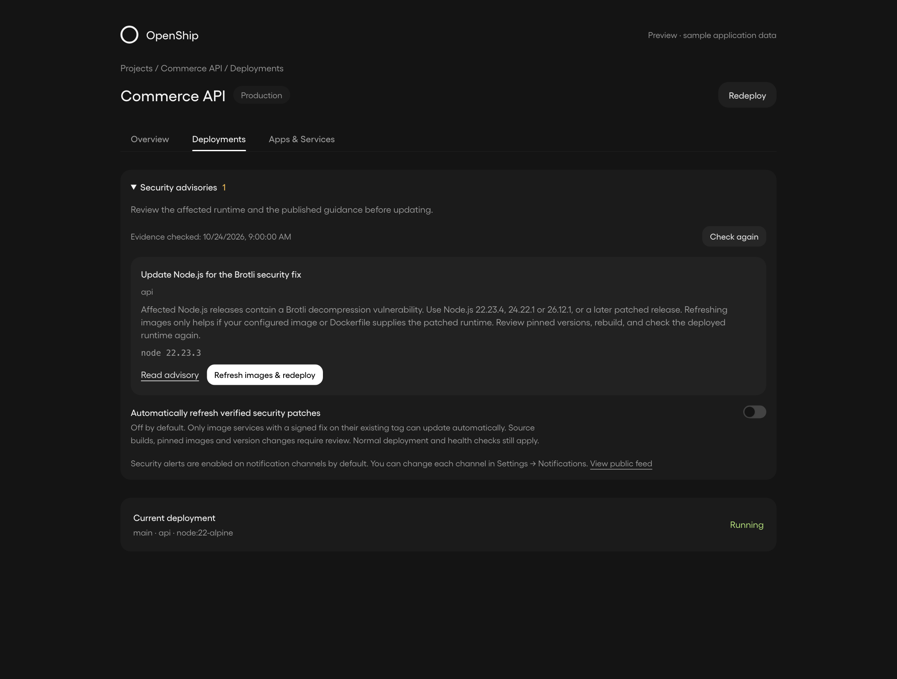

# Runtime security notice

These screenshots render the real `RuntimeSecurityNotice` component with the
dashboard's Gellix font and dim theme. The surrounding project is sample data;
the notice uses the public Node.js advisory and a synthetic affected runtime.
They are UI evidence, not proof that a live application was scanned or patched.



[Mobile screenshot](advisory-found-mobile.png) · [Browser checks](browser-checks.json)

Run the dashboard development server, then:

```sh
node scripts/screenshots/security-advisories/capture.mjs
```

Set `SCREENSHOT_ORIGIN` if it is not at `http://localhost:3001`, and
`PLAYWRIGHT_MODULE` to an installed Playwright entry point if needed.
The script temporarily creates a development-only page and always removes it.
It runs in an isolated browser context and intercepts every API request: it never
uses a real login, sends a notification or deploys a project. Consent changes and
the Apply action only exercise the real browser handlers against fixture responses.
